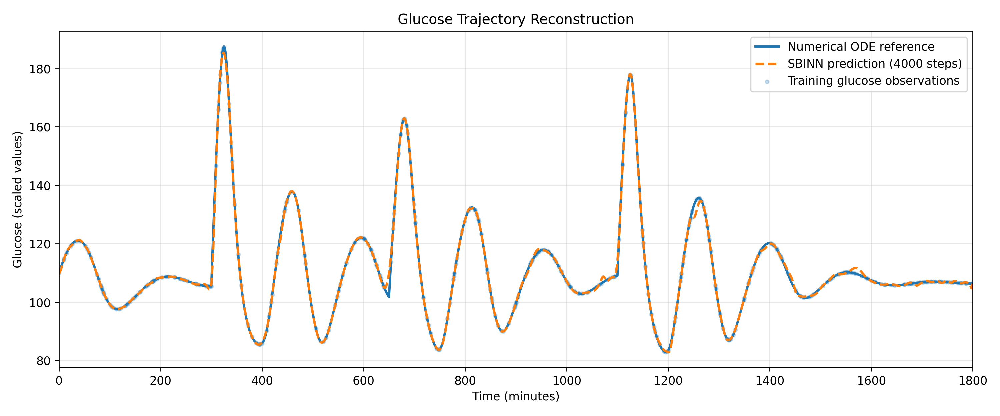
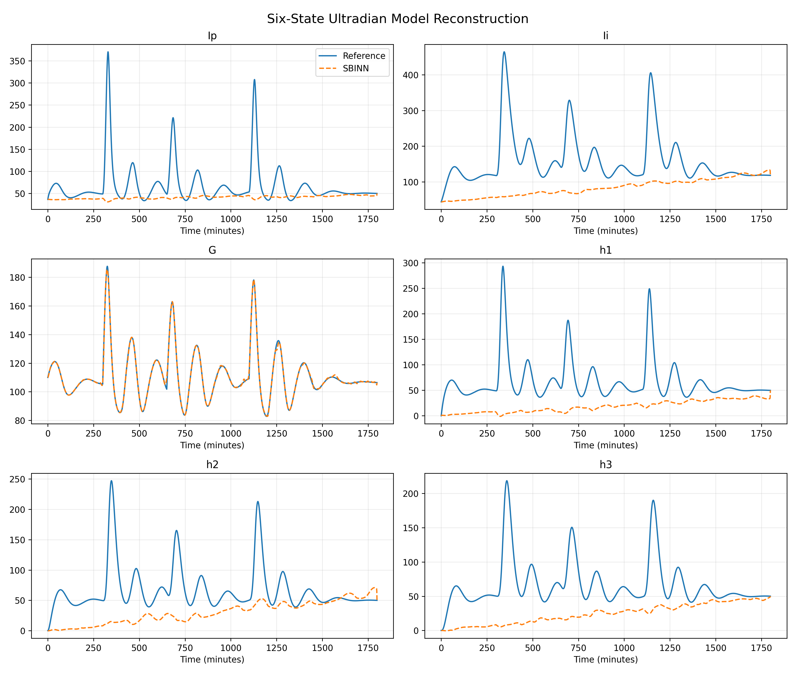
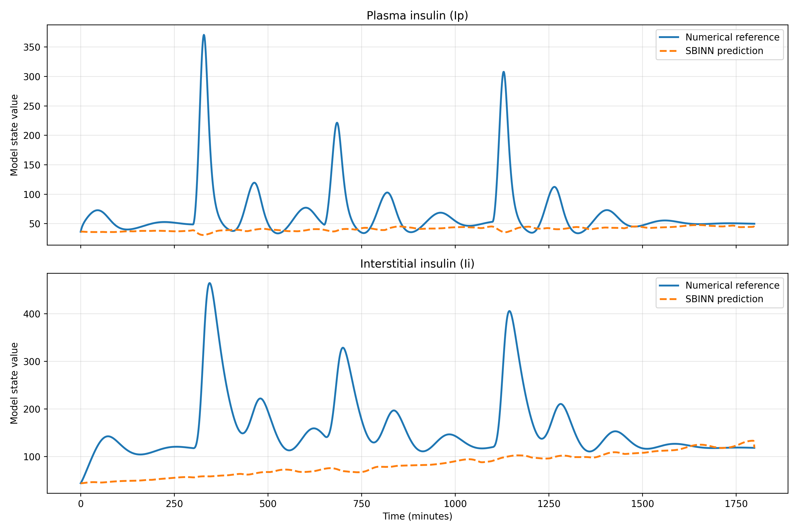
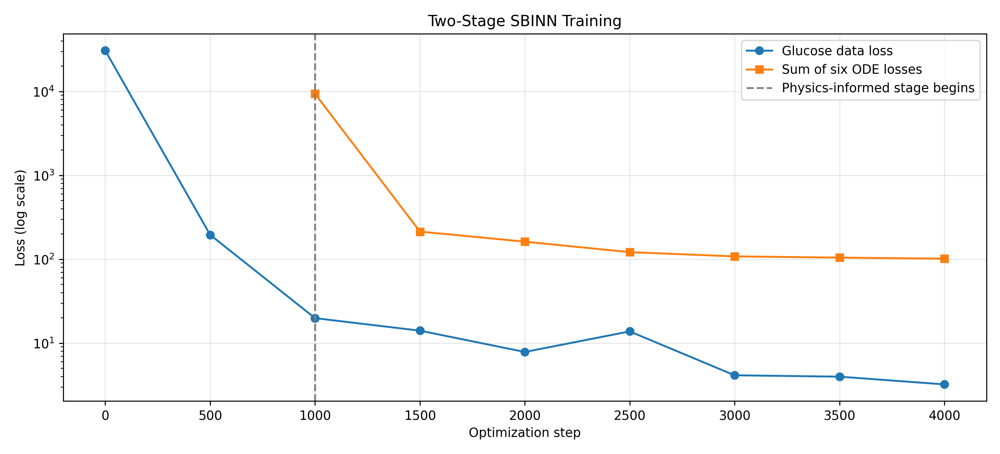
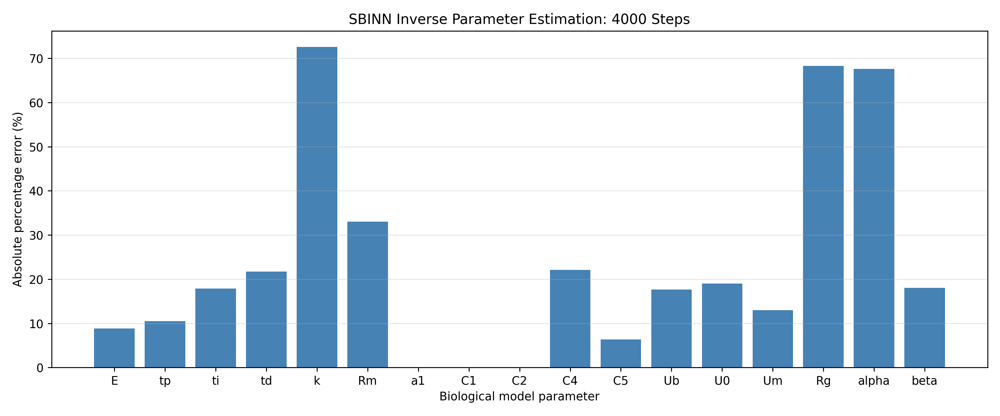

# SBINN Reproduction: Ultradian Glucose–Insulin Dynamics

**A preliminary reproduction study of systems biology-informed neural networks for physiological trajectory reconstruction and biological parameter estimation.**

This repository presents an experimental investigation of the six-state ultradian endocrine model using a **Systems Biology-Informed Neural Network (SBINN)**.

The study was conducted as a research reproduction exercise based on the work of **Yazdani et al. (2020)**, using the later PyTorch/DeepXDE implementation released by the Lu Group.

The investigation focuses on two objectives:

1. **Forward problem:** Reconstruct glucose–insulin dynamics while satisfying the governing ordinary differential equations (ODEs).
2. **Inverse problem:** Estimate unknown biological model parameters from physiological observations and physics-based constraints.

The repository includes implementation scripts, generated reference data, training outputs, parameter estimates, evaluation metrics, and visualizations.

---

## 1. Research Background

Traditional neural networks learn relationships between inputs and outputs using observational data. Physics-informed neural networks additionally incorporate governing equations into the training objective.

SBINNs extend this principle to biological dynamical systems, where observations may be sparse and certain physiological states or model parameters may be unknown.

The ultradian glucose–insulin model provides a benchmark for investigating whether a neural network can reconstruct physiological trajectories and estimate biological parameters while respecting the underlying system dynamics.

**Reference paper:**

Yazdani, A., Lu, L., Raissi, M., & Karniadakis, G. E. (2020). *Systems biology informed deep learning for inferring parameters and hidden dynamics*. PLOS Computational Biology, 16(11), e1007575.

https://doi.org/10.1371/journal.pcbi.1007575

---

## 2. Ultradian Glucose–Insulin Model

The ultradian endocrine model consists of six coupled nonlinear ordinary differential equations describing the interaction between glucose and insulin.

The six physiological states are:

| State | Description |
|---|---|
| Ip | Plasma insulin concentration |
| Ii | Interstitial insulin concentration |
| G | Blood glucose concentration |
| h1 | First delayed insulin-action state |
| h2 | Second delayed insulin-action state |
| h3 | Third delayed insulin-action state |

The system can be represented as:

\[
\frac{d\mathbf{y}}{dt}
=
\mathbf{f}(\mathbf{y}, \boldsymbol{\theta}, t)
\]

where:

- \(\mathbf{y} = [I_p, I_i, G, h_1, h_2, h_3]\) represents the physiological states.
- \(\boldsymbol{\theta}\) represents biological model parameters.
- \(t\) represents time.
- \(\mathbf{f}\) represents the nonlinear biological dynamics.

A neural network approximates the six time-dependent states, and automatic differentiation is used to compute their temporal derivatives.

The training objective combines observational constraints with residuals of the governing equations.

---

## 3. Methodology

### 3.1 Reference Data Generation

Synthetic physiological trajectories were generated using a numerical ODE solver.

The updated SBINN implementation provides reference trajectories for all six physiological states.

**Dataset configuration:**

| Property | Configuration |
|---|---|
| Model | Six-state ultradian endocrine model |
| Reference solver | SciPy numerical ODE integration |
| Generated reference points | 3,000 |
| Reported evaluation interval | 0–1799 minutes |
| Meal event times | 300, 650, 1100, and 2000 minutes |
| Training observations | Glucose observations with additional endpoint constraints |

The meal at 2000 minutes lies outside the reported 0–1799-minute training interval.

### 3.2 Neural Network Architecture

The SBINN implementation uses a fully connected neural network to approximate the physiological states.

| Component | Configuration |
|---|---|
| Framework | DeepXDE |
| Backend | PyTorch |
| Neural network | Fully connected feedforward network |
| Hidden layers | 3 |
| Neurons per hidden layer | 128 |
| Activation function | Swish |
| Output variables | Six physiological states |
| Optimizer | Adam |
| Learning rate | 0.001 |

The model incorporates six ODE residual constraints alongside observational losses.

### 3.3 Two-Stage Training

Training was conducted in two consecutive stages.

**Stage 1: Supervised initialization**

- 1,000 optimization steps.
- Initial fitting using glucose observations and associated constraints.
- Establishes an initial approximation of the physiological trajectories.

**Stage 2: Physics-informed optimization**

- 3,000 additional optimization steps.
- Introduces the six governing ODE residuals.
- Jointly improves trajectory reconstruction and biological parameter estimation.

**Total optimization: 4,000 steps.**

---

## 4. Experimental Results

### 4.1 Glucose Trajectory Reconstruction

The SBINN prediction was evaluated against the numerically generated reference glucose trajectory.



*Figure 1. Numerical reference glucose trajectory compared with the SBINN reconstruction after 4,000 optimization steps.*

**Evaluation metrics**

| Metric | Result |
|---|---:|
| Root Mean Squared Error (RMSE) | **0.7519** |
| Mean Absolute Error (MAE) | **0.3535** |
| Relative L2 Error | **0.00669** |

Predictions were aligned with the reference time grid, and glucose values were divided by 100 for the reported evaluation scale.

These results demonstrate close reconstruction of the numerical glucose trajectory within the evaluated time interval.

**Important:** These are training-interval reconstruction results, not independent future forecasting results.

### 4.2 Reconstruction of Six Physiological States

The network predicts all six state variables:

- Plasma insulin (Ip)
- Interstitial insulin (Ii)
- Blood glucose (G)
- Delayed states h1, h2, and h3



*Figure 2. Comparison between reference solutions and SBINN-predicted trajectories for the six physiological states.*

A separate visualization provides a closer comparison of plasma and interstitial insulin.



*Figure 3. Plasma and interstitial insulin trajectories reconstructed by the SBINN.*

### 4.3 Training Loss Analysis

The training procedure consists of supervised initialization followed by physics-informed optimization.



*Figure 4. Training loss history across the supervised and physics-informed optimization stages.*

The second training stage incorporates the governing differential equations, allowing biological constraints to influence the learned trajectories.

Because the training objectives and loss contributions differ between stages, their total losses should not be interpreted as directly comparable.

---

## 5. Inverse Biological Parameter Estimation

In addition to reconstructing physiological states, the SBINN was used to estimate biological model parameters.

The experiment records 17 biological parameters.

Of these:

- **14 parameters changed during optimization.**
- **3 parameters (a1, C1, C2) remained unchanged from their initialization values.**

The unchanged parameters should not be interpreted as independently recovered parameters.

### Parameter Estimation Performance

| Measure | Result |
|---|---:|
| Parameters in comparison | 17 |
| Parameters changed during training | 14 |
| Parameters unchanged | 3 |
| MAPE across all 17 parameters | 23.32% |
| MAPE across the 14 changed parameters | **28.32%** |

### Parameter Error Visualization



*Figure 5. Absolute percentage errors between reference and estimated biological model parameters.*

Although glucose trajectory reconstruction achieved relatively low error, biological parameter estimation remained more challenging.

Several parameters exhibited substantial estimation errors, suggesting potential parameter-identifiability and optimization difficulties.

Detailed results are available in:

- [Inverse parameter comparison](tables/inverse_parameter_comparison.csv)
- [Parameter estimation history](tables/parameter_history.csv)
- [Experiment evaluation metrics](tables/experiment_metrics.csv)

---

## 6. Repository Structure

```text
SBINN-Ultradian-Glucose-Insulin-Reproduction/
│
├── figures/
│   ├── 01_glucose_reference_vs_sbinn.png
│   ├── 02_insulin_reference_vs_sbinn.png
│   ├── 03_training_loss.png
│   ├── 04_inverse_parameter_errors.png
│   └── 05_all_six_state_trajectories.png
│
├── tables/
│   ├── experiment_metrics.csv
│   ├── inverse_parameter_comparison.csv
│   └── parameter_history.csv
│
├── source_code/
│   ├── data_generation.py
│   ├── sbinn_experiment_1.py
│   ├── sbinn_pytorch.py
│   ├── sbinn_smoke_test.py
│   └── variable_to_parameter_transform.py
│
├── experiment_data/
│   └── Generated reference data and training outputs
│
├── README_EXPERIMENT.txt
│
└── README.md
```

---

## 7. Reproducibility

### Dependencies

The experiment was conducted in Google Colab using:

- Python
- PyTorch
- DeepXDE
- NumPy
- SciPy
- pandas
- Matplotlib

The exact package versions and random seeds were not recorded in the experiment archive. Consequently, a fresh training run may not reproduce the reported numerical results exactly.

### Step 1: Obtain the Repository

```bash
git clone https://github.com/sajjadahmad-dev/SBINN-Ultradian-Glucose-Insulin-Reproduction.git
```

```bash
cd SBINN-Ultradian-Glucose-Insulin-Reproduction
```

### Step 2: Generate the Reference Data

Run:

```bash
python source_code/data_generation.py
```

The reference data must be generated in, or made available to, the working directory expected by the training script.

### Step 3: Run the SBINN Experiment

Configure DeepXDE to use its PyTorch backend.

The experimental implementation is available in:

```text
source_code/sbinn_experiment_1.py
```

The script uses the generated `glucose.dat` and `meal.dat` files and imports the parameter-conversion utility.

**Note:** The archived training script contains an outdated postprocessing call. The training results themselves are provided in this repository.

### Step 4: Convert Learned Parameters

For the completed 4,000-step experiment, the corrected parameter conversion is:

```python
import variable_to_parameter_transform

variable_to_parameter_transform.variable_file(
    1000,
    20,
    3000,
    "variables.csv"
)
```

The resulting converted parameter estimates are included in:

```text
experiment_data/varlist.csv
tables/parameter_history.csv
```

The archived outputs and figures document the completed experiment; the unmodified script should not be considered a fully automated, one-command reproduction pipeline.

---

## 8. Challenges and Limitations

The experiments revealed several important challenges.

**1. Biological parameter identifiability**

Some parameter estimates remained substantially different from their reference values despite accurate glucose reconstruction.

**2. Optimization sensitivity**

Different biological parameters can influence the model dynamics at different scales, creating challenges for joint optimization.

**3. Unchanged parameters**

Three recorded parameters remained at their initialization values throughout the reported optimization history. The precise reason requires further investigation.

**4. Limited forecasting evaluation**

The reported glucose metrics were calculated on the training interval. Independent extrapolation to unseen future intervals has not yet been validated.

**5. Differences from the original implementation**

This experiment uses a later PyTorch/DeepXDE SBINN implementation rather than reproducing every experimental configuration from the 2020 paper.

The results should therefore be interpreted as a **preliminary reproduction study**, not as an exact replication of all published findings.

---

## 9. Future Research Directions

Potential improvements include:

1. Investigating parameter sensitivity and identifying why some parameters remain unchanged.
2. Evaluating model performance on independently held-out time intervals.
3. Studying the effects of observation density, noise, network initialization, and training duration.
4. Exploring adaptive loss weighting and improved parameter estimation strategies.
5. Reproducing the original paper's experimental configuration more closely.

These directions may help improve the reliability of inverse parameter estimation and assess the model's generalization beyond the training interval.

---

## 10. References and Attribution

**[1] Original Research Paper**

Yazdani, A., Lu, L., Raissi, M., & Karniadakis, G. E. (2020).

*Systems biology informed deep learning for inferring parameters and hidden dynamics.*

PLOS Computational Biology, 16(11), e1007575.

https://doi.org/10.1371/journal.pcbi.1007575

**[2] SBINN PyTorch Implementation**

Lu Group — SBINN implementation.

https://github.com/lu-group/sbinn

**[3] Original SBINNs Repository**

Yazdani et al. — Original implementation.

https://github.com/alirezayazdani1/SBINNs

### Attribution

The SBINN methodology and upstream implementations were developed by their respective authors.

This repository documents a reproduction exercise involving an experimental training configuration, numerical evaluation, parameter comparison, visualizations, and analysis.

Reused source code remains subject to its original licensing and attribution requirements.

---

**Sajjad Ahmad**

BS Computer Science  

Research Interests: Machine Learning, Deep Learning, Scientific Machine Learning, and Physics-Informed Neural Networks.

**GitHub:** https://github.com/sajjadahmad-dev

**Research Portfolio:** https://sajjad-ahmad-ai.vercel.app/
